# MiseDeck

> [简体中文](./zh-CN/README.md)

**A desktop GUI for [mise](https://mise.jdx.dev), the polyglot tool version manager.** It is built from mise's own concepts, not an invented layer on top: each page mirrors a part of the CLI, and every change it makes runs a real `mise` command, shown verbatim — command, logs, exit code — in the execution panel. MiseDeck is an independent community project, not affiliated with mise or its maintainer.

> **Status: 1.0.0** — the first stable release, after 16 tagged betas between `v1.0.0-beta.1` and `v1.0.0-beta.17` (September–October 2026). macOS on Apple Silicon is the polished target; Windows x64 runs and has been exercised end-to-end on one real Windows 11 machine, though its installer is untested; Linux is packaged but not verified on real hardware.

## Why

- **Resolved, not guessed**: installed tools, active versions, outdated upgrades, per-directory overrides — every row labeled with the config file it came from.
- **Nothing hidden**: writes go through the CLI, and the execution panel keeps the command that ran and what it printed.
- **Directory-aware without a terminal**: point the app at a directory and see what mise resolves there.

## Features

Every page works on **Global** (`mise -g`) or on a **directory** you choose; recent directories are remembered. Directory-scoped writes stay disabled until that directory's config is trusted.

| Page | What it does | Commands |
| --- | --- | --- |
| **Home** | Version gate, guided install when mise is missing, one-click self-update | `mise version`, `mise self-update` |
| **Tools** | Installed and active tools; registry search; install / use / uninstall per version; switch version; upgrade outdated; link a local build; filter, paginate | `mise ls`, `mise registry`, `mise ls-remote`, `mise install`, `mise use`, `mise uninstall`, `mise upgrade`, `mise unuse`, `mise outdated`, `mise link` |
| **Overview** | Resolved tools and env, config files in precedence order with contents, `mise.lock` — each row with its source | `mise ls`, `mise env`, `mise config ls` |
| **Env** | Add, edit, rename, unset vars; source badges; warns when a var is defined outside the write scope | `mise env`, `mise set`, `mise unset` |
| **Tasks** | List, filter, run with live output, create and edit, open the config in your editor | `mise tasks ls`, `mise run`, `mise tasks add`, `mise tasks edit` |
| **Settings** | View, filter, edit, unset settings, including `--all`; table-typed keys are read-only with an explanation | `mise settings ls`, `mise settings set`, `mise settings unset` |
| **Doctor** | Status, shell activation, warnings, config files, resolved toolset; a copyable report whose header names the running MiseDeck build; tinted raw output as fallback | `mise doctor` |
| **Plugins** | Installed plugins; install from a git URL; uninstall | `mise plugins ls`, `mise plugins install`, `mise plugins uninstall` |

Beyond the pages:

- **Execution panel**: exact argv, working directory, streamed logs, duration, exit code, copy-command, cancel, dismiss. Several commands can run at once.
- **Trust**: an untrusted directory is read-only, with a banner and a one-click `mise trust`.
- **Shell activation**: detects a missing `mise activate` line in your shell rc and shows what to add; can open a terminal at the current directory.
- **Failures stay visible**: a failed load keeps its stderr and a retry on screen instead of rendering an empty page, and a rejected command with no place on the page raises a dismissible notice instead of failing silently.
- **App version and updates**: the running version sits in the sidebar footer; a silent check at most once per 24 hours marks a newer build with a dot, checking manually is always available, and a newer build hands you its GitHub Release page — the app never downloads or installs a build itself (ADR-0009).
- Bilingual UI (English / 简体中文) and light/dark themes.

## Requirements

- **mise ≥ 2025.12.5** — MiseDeck calls the CLI rather than bundling it; the Home page can install it.
- **macOS on Apple Silicon** for the prebuilt app; Windows x64 builds run but are still experimental; Linux x86_64 packages are attached but unverified on real hardware.
- Building from source: Rust stable and Node.js 22+.

## Install

Prebuilt (unsigned) binaries are attached to [GitHub Releases](https://github.com/cherishfall/misedeck/releases). Each release carries a `SHA256SUMS` file covering every asset — run `shasum -a 256 -c SHA256SUMS` (macOS) or `sha256sum -c SHA256SUMS` (Linux) in the folder you downloaded into.

### macOS (Apple Silicon)

1. Download `MiseDeck_<version>_aarch64.dmg` from the latest release.
2. Open the DMG and drag **MiseDeck** into `/Applications`.
3. The first launch is blocked by Gatekeeper — see below.

### macOS: the build is unsigned

Published macOS builds carry no Apple Developer ID signature and are not notarized, so Gatekeeper treats them as untrusted:

| What you see | When |
| --- | --- |
| *"misedeck" is damaged and can't be opened. You should move it to the Trash.* | after dragging the app out of the DMG — the most common symptom |
| *"misedeck" cannot be opened because the developer cannot be verified.* | first double-click |
| *"misedeck" cannot be opened because Apple cannot check it for malicious software.* | same, on newer macOS |

Nothing is corrupt — it is the quarantine flag (`com.apple.quarantine`) that macOS puts on unsigned downloads. Clear it on the installed copy:

```bash
xattr -dr com.apple.quarantine /Applications/MiseDeck.app
```

Then open the app normally. No `sudo` needed; `-d` deletes the attribute, `-r` applies it to the whole bundle.

Without a terminal: launch once and dismiss the dialog, open **System Settings → Privacy & Security → Security**, click **Open Anyway**, authenticate, then open the app again and confirm **Open**.

If it still will not open:

- Run the copy in `/Applications`, not the one inside the mounted DMG (that copy is read-only).
- Check the flag is gone: `xattr -p com.apple.quarantine /Applications/MiseDeck.app` should answer *No such xattr*.
- Re-apply after every reinstall — each new download carries the flag again.
- Avoid disabling Gatekeeper system-wide (`sudo spctl --master-disable`); clearing this app is the narrow fix.

### Linux x86_64

- Debian/Ubuntu: `MiseDeck_<version>_amd64.deb` (the deb package name is `mise-deck`)
- Fedora/RHEL: `MiseDeck-<version>-1.x86_64.rpm`
- Any distro: `MiseDeck_<version>_amd64.AppImage` — `chmod +x`, then run.

Packaged by CI; the maintainer has not run these on a real desktop.

### Windows x64 — experimental

Each release attaches `MiseDeck_<version>_x64-setup.exe`. CI compiles it and runs the same Rust test suite as Linux, plus the full frontend gate. The app has been run end-to-end on one real Windows 11 machine — all eight pages, the IPC commands, the write round-trip and the process-tree kill passed ([report](./docs/feedback/windows-hardware-verification.md)) — but the installer itself has not been installed on real hardware, and Windows has no release history yet. Expect breakage; feedback is welcome.

## Run from source

The repo root is not the app: `package.json` lives in the `misedeck/` subdirectory, and every npm command has to run from there.

```bash
git clone https://github.com/cherishfall/misedeck.git
cd misedeck/misedeck   # repo root → app directory (package.json is here)
npm install
```

For an existing clone, start from `<repo>/misedeck` — `npm install` at the repo root fails with `ENOENT … package.json`.

### Development

```bash
npm run tauri dev
```

This starts the Vite dev server on `localhost:1420` and opens the app window against it. Frontend edits hot-reload; changes under `src-tauri/` rebuild the Rust side and restart the window. The first launch compiles everything from scratch (minutes), later ones are incremental.

`npm run dev` on its own only serves the frontend in a browser — the Rust backend and its commands are missing, so use `npm run tauri dev` to actually exercise the app.

Extra prerequisites on top of Rust stable + Node 22: macOS needs the Xcode Command Line Tools (`xcode-select --install`); Linux needs the WebKitGTK/GTK development packages listed in [`.github/workflows/release.yml`](./.github/workflows/release.yml).

### Build installers

```bash
npm run tauri build
```

Bundles land in `src-tauri/target/release/bundle/` — `dmg/` and `macos/` on macOS, `nsis/` on Windows, `deb/`, `rpm/`, `appimage/` on Linux. macOS builds come out unsigned, exactly like the released ones.

`npm run ci` is the full frontend gate — CI's Windows job runs it verbatim. Its 18 steps, in order: `typecheck`, `lint:eslint` (React Hooks rules), `test`, fourteen lint guards (i18n parity and concatenation, CSS tokens/type/spacing/tracking, ellipsis, command hints, install-echo parity, tool-argv parity, modal focus, nested interactives, page layout, invoke wrapper), and `build`. The Rust checks are separate: `cargo check --all-targets`, `cargo clippy --all-targets -- -D warnings` and `cargo test --all-targets` on Ubuntu, and `cargo test --all-targets` plus a `cargo build` compile smoke on Windows — the same suite on both, not a Windows-only subset.

## Known limitations

- macOS builds are unsigned and not notarized (see above).
- No auto-update: even when a newer build exists, the panel stops at its Release page — you download and install it yourself, and macOS needs the `xattr` fix re-applied afterwards.
- Cancel does not wait for the process: the panel marks the run cancelled immediately and MiseDeck then kills the run's whole process tree (a `curl | sh` install, a `mise run` task shell). Closing the app kills anything still running.
- Update checks shell out to `curl`, which ignores the Windows system proxy: a machine that reaches GitHub only through a proxy never sees an update. Set `https_proxy` (e.g. `https_proxy=http://127.0.0.1:7890`) before launching the app. A failed check is retryable, not fatal.
- Windows is experimental: CI runs the full suite there, and the app has been exercised on one Windows 11 machine, but the installer is untested and the platform has no release history yet; Linux packages are built but not verified on a desktop.
- Linux needs **WebKitGTK 2.40 or newer** (Ubuntu 22.04+, Debian 12+, Fedora 38+). The whole palette is derived with `color-mix()`, so an older webview does not degrade gracefully — borders and elevated surfaces lose their colours. Packages are built against Ubuntu 22.04, so they run on any distro with glibc 2.35+. Verified on: none. Ubuntu 24.04 is the target, not a tested environment.
- No Intel macOS build; build from source if you need one.

## Screenshots

| English | 简体中文 |
| --- | --- |
| 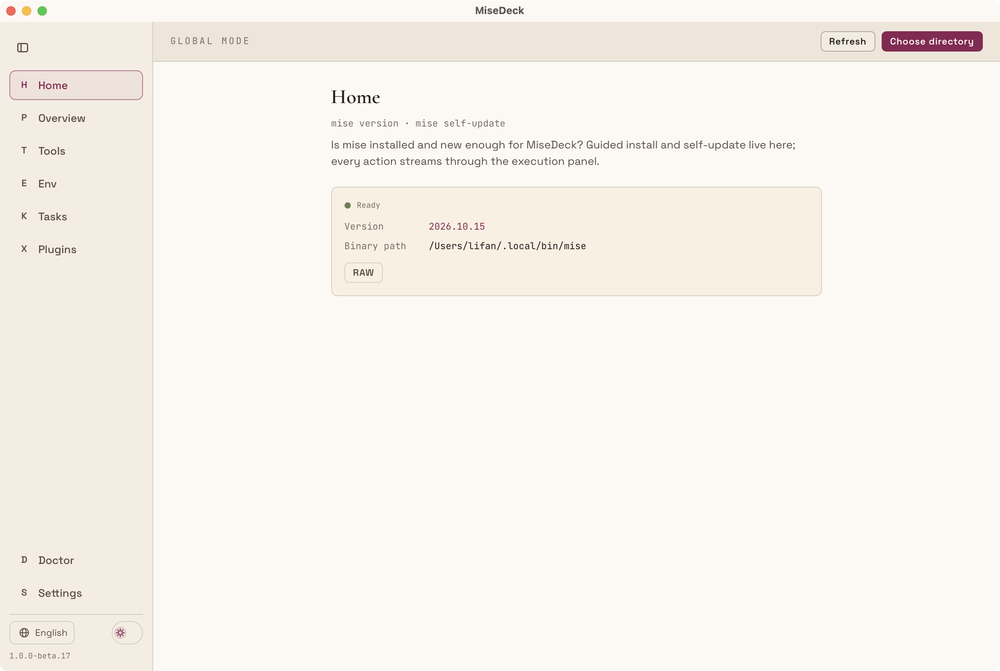 | 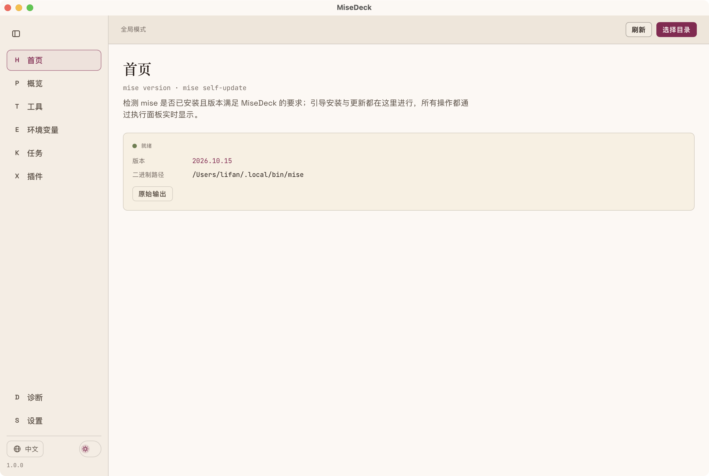 |
| 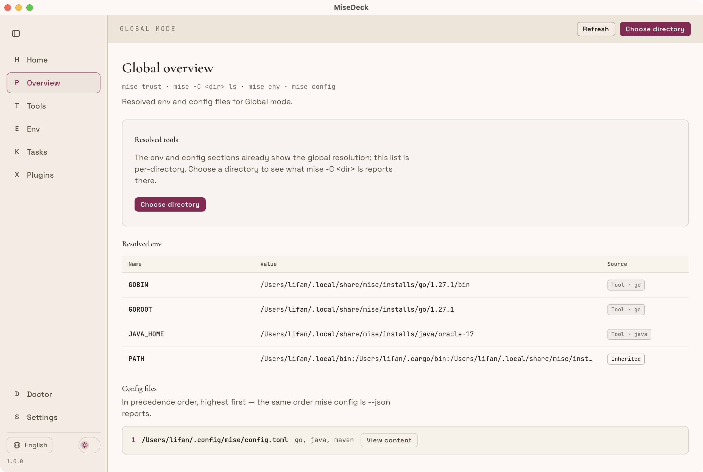 | 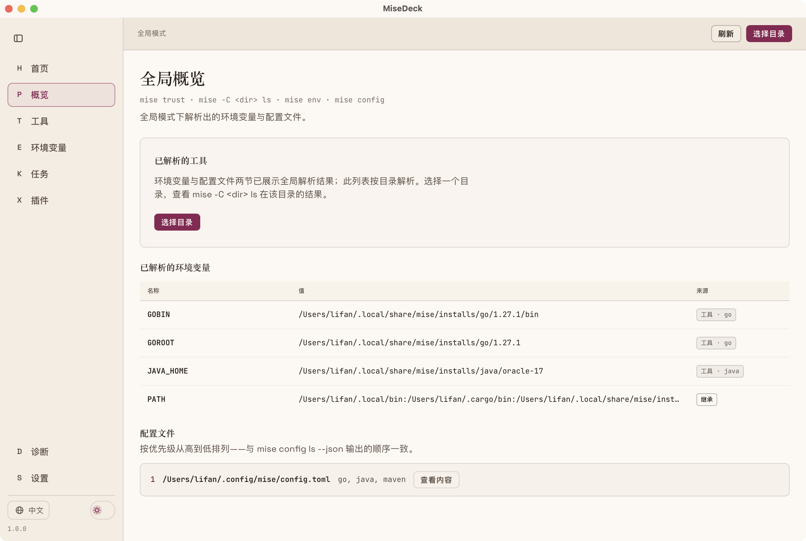 |
| 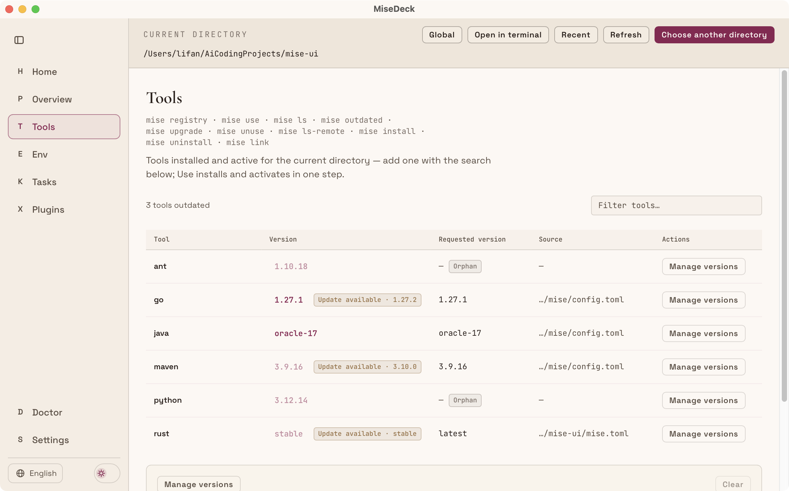 | 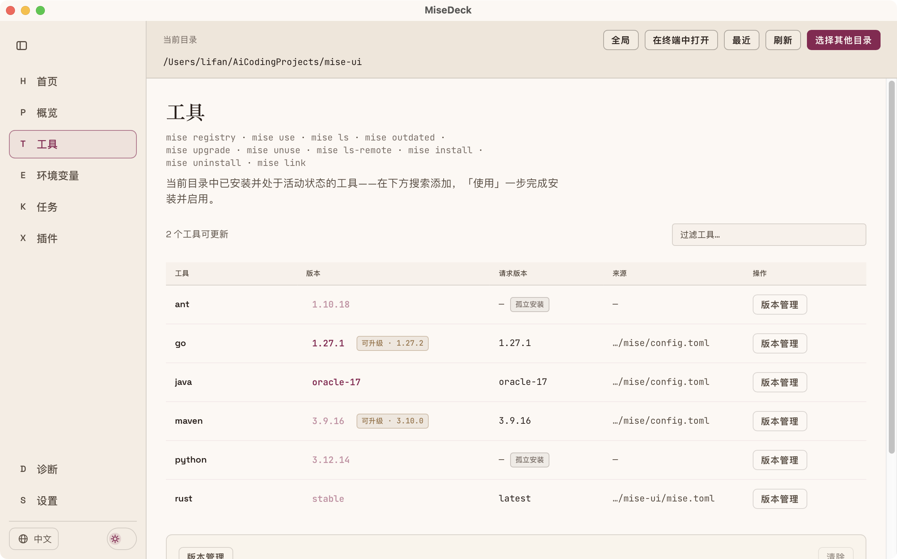 |
| 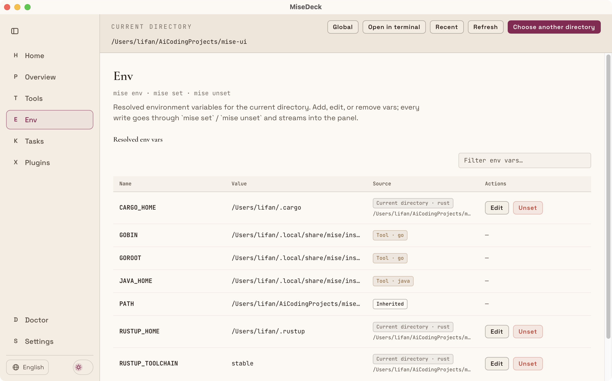 | 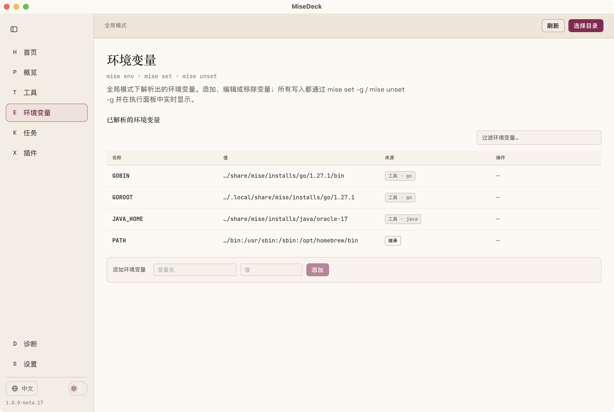 |
| 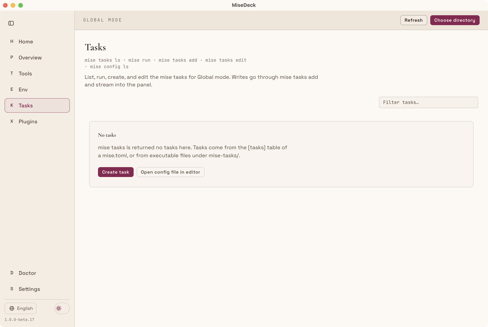 | 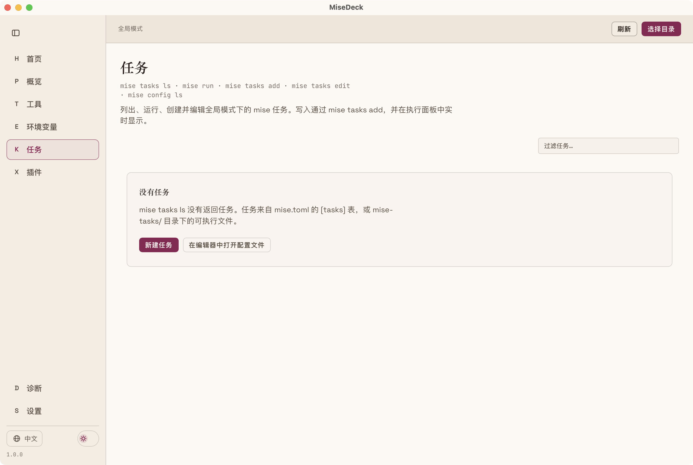 |
| 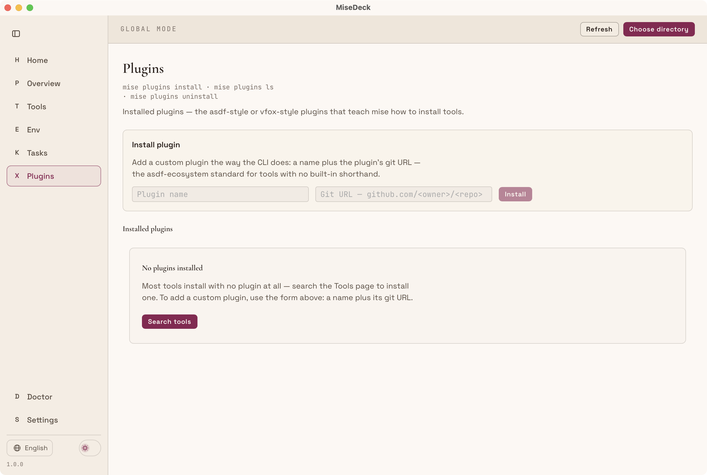 | 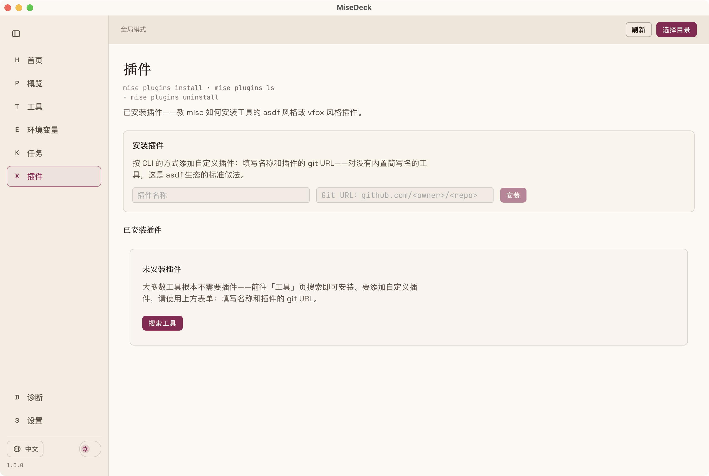 |
| 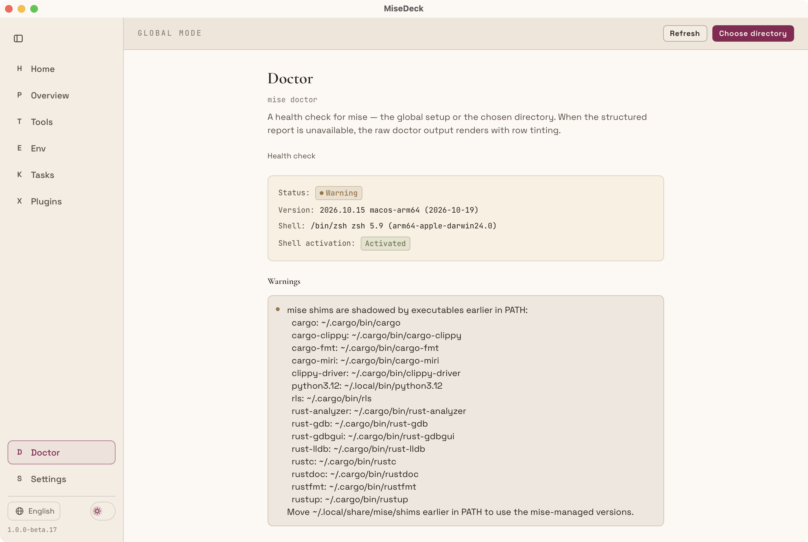 | 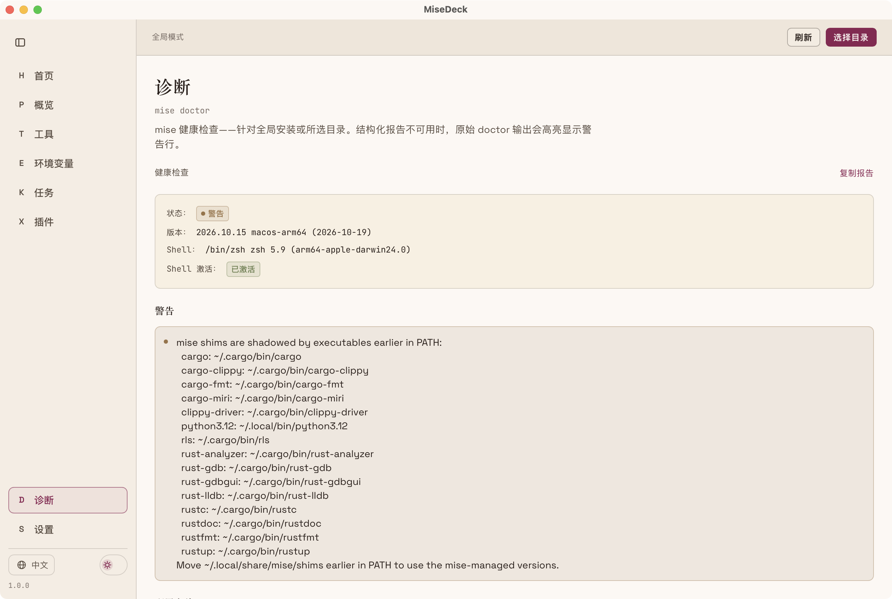 |
| 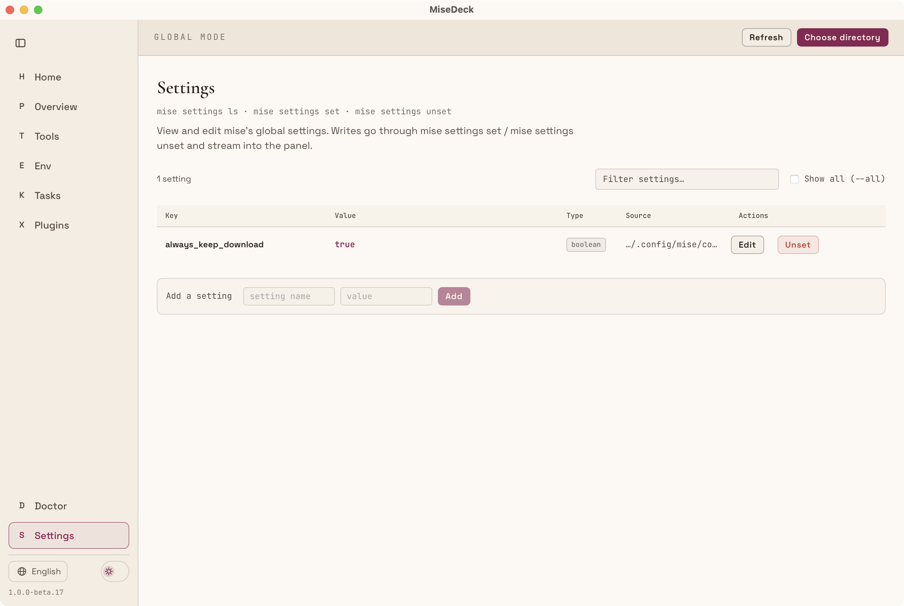 | 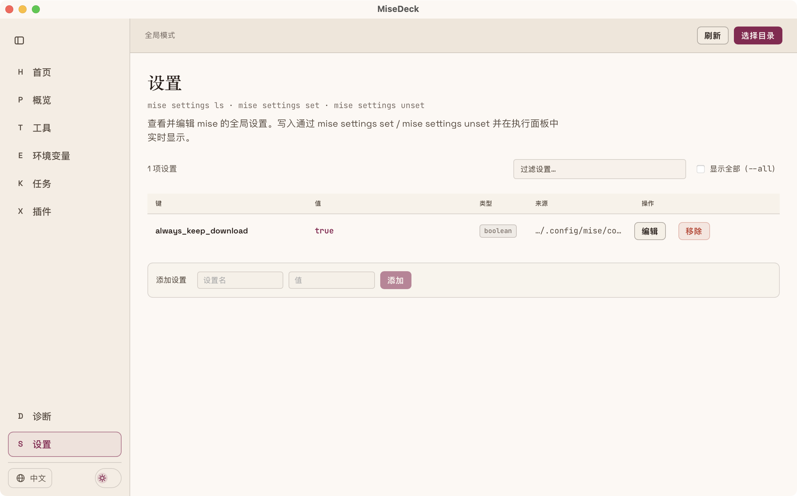 |

## Contributing

See [AGENTS.md](./AGENTS.md), the glossary in [CONTEXT.md](./CONTEXT.md), and [docs/adr/](./docs/adr/). Report bugs and feedback in [Issues](https://github.com/cherishfall/misedeck/issues).

## Disclaimer

MiseDeck is a community project, not affiliated with or endorsed by the official mise project.

## License

[MIT](./LICENSE)
