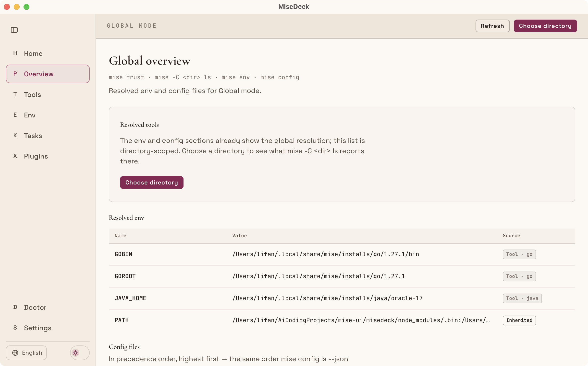
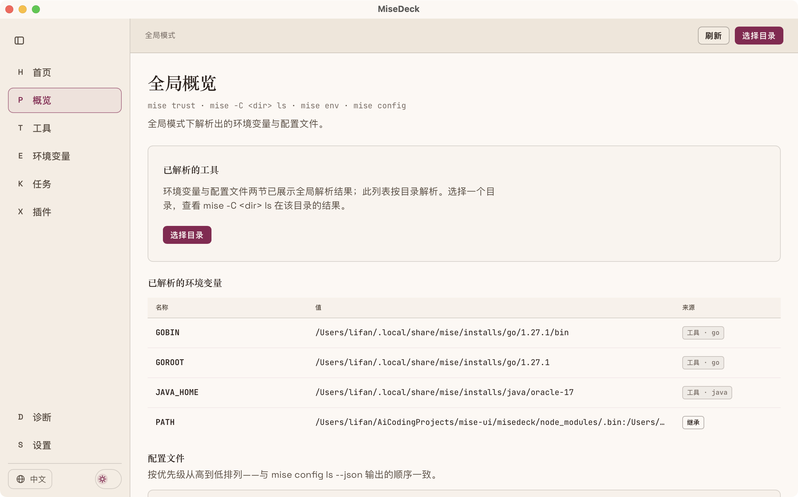

# MiseDeck

> [English](../README.md)

**[mise](https://mise.jdx.dev)（多语言工具版本管理器）的桌面 GUI。** 它用 mise 自己的概念构建，而不是在上面另造一层：每个页面镜像 CLI 的一部分，每次改动都真实执行一条 `mise` 命令，命令行、日志与退出码都原样留在执行面板里。

> **状态：公开测试版 `v1.0.0-beta.16`**（自 2026 年 8 月起共 15 个构建）。1.0 尚未定稿，文案与布局在 beta 之间仍会变化。macOS（Apple Silicon）是打磨过的目标平台；Linux 有包但未验证；Windows 为实验性支持。

## 为什么

- **展示解析结果，不靠猜**：已装工具、生效版本、可升级项、按目录的覆盖——每一行都标出来自哪个配置文件。
- **不藏黑箱**：写操作走 CLI，执行面板保留实际执行的命令和它的输出。
- **目录级配置，无需终端**：把应用指向一个目录，就能看到 mise 在该目录下解析出的结果。

## 功能

所有页面都作用在**全局**（`mise -g`）或你选定的**目录**上，最近使用的目录会被记住。目录作用域的写操作，在该目录的配置被信任之前保持禁用。

| 页面 | 可以做什么 | 背后的命令 |
| --- | --- | --- |
| **首页** | 版本检查；mise 缺失时引导安装；一键自我更新 | `mise version`、`mise self-update` |
| **工具** | 已装与生效的工具；registry 搜索；按版本安装、启用、卸载；切换版本；升级过时项；链接本地构建；过滤与翻页 | `mise ls`、`mise registry`、`mise ls-remote`、`mise install`、`mise use`、`mise uninstall`、`mise upgrade`、`mise unuse`、`mise outdated`、`mise link` |
| **概览** | 解析出的工具与环境变量、按优先级排列并可查看内容的配置文件、`mise.lock`——每行标注来源 | `mise ls`、`mise env`、`mise config ls` |
| **环境变量** | 新增、编辑、重命名、取消设置；来源标记；变量定义在写入作用域之外时给出警告 | `mise env`、`mise set`、`mise unset` |
| **任务** | 列出、过滤、带实时输出运行、新建与编辑、在编辑器中打开配置 | `mise tasks ls`、`mise run`、`mise tasks add`、`mise tasks edit` |
| **设置** | 查看、过滤、编辑、取消设置，含 `--all`；表类型的键只读并说明原因 | `mise settings ls`、`mise settings set`、`mise settings unset` |
| **诊断** | 状态、shell 激活、警告、配置文件、解析出的工具集；结构化数据不可用时回退到带染色的原始输出 | `mise doctor` |
| **插件** | 已安装插件；按 git URL 安装；卸载 | `mise plugins ls`、`mise plugins install`、`mise plugins uninstall` |

页面之外：

- **执行面板**：完整命令行、工作目录、流式日志、耗时、退出码、复制命令、取消、收起；可同时运行多条命令。
- **信任机制**：未信任的目录为只读，附横幅与一键 `mise trust`。
- **Shell 激活**：检测 shell rc 中缺失的 `mise activate` 并给出该行内容；可在当前目录打开终端。
- **失败可见**：加载或命令失败时，stderr 与重试留在界面上，而不是渲染一个空页面。
- 双语界面（English / 简体中文）与明暗两套主题。

## 环境要求

- **mise ≥ 2025.1.0**——MiseDeck 调用 CLI，不内置它；mise 缺失时首页可以安装。
- **macOS（Apple Silicon）** 使用预构建包；Linux x86_64 有包但未验证；Windows x64 为实验性支持。
- 从源码构建：Rust stable 与 Node.js 22+。

## 安装

未签名的预构建文件附在 [GitHub Releases](https://github.com/cherishfall/misedeck/releases)。

### macOS（Apple Silicon）

1. 从最新 release 下载 `MiseDeck_<version>_aarch64.dmg`。
2. 打开 DMG，把 **MiseDeck** 拖进 `/Applications`。
3. 首次启动会被 Gatekeeper 拦下——见下一节。

### macOS：构建未签名

发布的 macOS 构建没有 Apple Developer ID 签名，也没有公证，因此 Gatekeeper 把它当作不可信：

| 看到的提示 | 出现时机 |
| --- | --- |
| **“misedeck”已损坏，无法打开。您应该将它移到废纸篓。** | 把应用从 DMG 拖出后打开——最常见的症状 |
| **“misedeck”无法打开，因为无法验证开发者。** | 首次双击 |
| **“misedeck”无法打开，因为 Apple 无法检查其是否包含恶意软件。** | 同上，出现在较新的 macOS 上 |

文件没有损坏——这是 macOS 给未签名下载打上的隔离标记（`com.apple.quarantine`）。对已安装的副本清除它：

```bash
xattr -dr com.apple.quarantine /Applications/MiseDeck.app
```

然后正常打开。不需要 `sudo`；`-d` 删除该属性，`-r` 递归作用于整个应用包。

不想用终端：先打开一次并关掉对话框，进入**系统设置 → 隐私与安全性 → 安全性**，点击**仍要打开**，完成认证，再打开应用并确认**打开**。

仍然打不开时：

- 运行 `/Applications` 里的副本，而不是挂载中 DMG 里的那个（后者只读）。
- 确认标记已清除：`xattr -p com.apple.quarantine /Applications/MiseDeck.app` 应返回 *No such xattr*。
- 每次重装后都要重新执行——新下载的文件会重新带上标记。
- 避免全局关闭 Gatekeeper（`sudo spctl --master-disable`）；只清理这一个应用即可。

### Linux x86_64

- Debian/Ubuntu：`MiseDeck_<version>_amd64.deb`（deb 包名是 `mise-deck`）
- Fedora/RHEL：`MiseDeck-<version>-1.x86_64.rpm`
- 任意发行版：`MiseDeck_<version>_amd64.AppImage`——先 `chmod +x`，再运行。

由 CI 打包，维护者尚未在真实桌面上运行过。

### Windows x64——实验性

每个 release 都会附带 `MiseDeck_<version>_x64-setup.exe`。Windows 尚未验证：真机测试正在进行，Windows 上定位 mise 可执行文件的问题仍在修复（[#208](https://github.com/cherishfall/misedeck/issues/208)）。请预期尚不可用；欢迎反馈。

## 从源码运行

仓库根目录不是应用目录：`package.json` 在 `misedeck/` 子目录里，所有 npm 命令都要在那里执行。

```bash
git clone https://github.com/cherishfall/misedeck.git
cd misedeck/misedeck   # 仓库根 → 应用目录（package.json 在这里）
npm install
```

已有本地克隆时，从 `<repo>/misedeck` 开始——在仓库根目录执行 `npm install` 会报 `ENOENT … package.json`。

### 开发模式

```bash
npm run tauri dev
```

这会启动 Vite 开发服务器（`localhost:1420`）并打开连到它的应用窗口。前端改动热更新；`src-tauri/` 下的改动会重新编译 Rust 并重启窗口。首次启动要全量编译（数分钟），之后是增量。

单独跑 `npm run dev` 只是在浏览器里提供前端页面——Rust 后端和它的命令都不在，要真正跑应用请用 `npm run tauri dev`。

除 Rust stable 与 Node 22 之外：macOS 需要 Xcode Command Line Tools（`xcode-select --install`）；Linux 需要 [`.github/workflows/release.yml`](../.github/workflows/release.yml) 里列出的 WebKitGTK/GTK 开发包。

### 构建安装包

```bash
npm run tauri build
```

产物在 `src-tauri/target/release/bundle/`——macOS 是 `dmg/` 与 `macos/`，Windows 是 `nsis/`，Linux 是 `deb/`、`rpm/`、`appimage/`。macOS 构建和正式发布的一样，都是未签名的。

`npm run ci` 跑的就是 CI 那一套：类型检查、测试、i18n/CSS 的 lint 守卫，以及生产前端构建。

## 已知限制

- macOS 构建未签名、未公证（见上）。
- 没有自动更新：侧栏页脚的版本号点开可以检查 GitHub 上有没有更新的构建，然后给出它的 Release 页。MiseDeck 不会自行下载或安装——macOS 装好后仍需重新执行一次 `xattr`。
- 取消不会等待进程结束：面板立即把这次运行标记为 cancelled，随后 MiseDeck 终止该次运行的整个进程树（`curl | sh` 安装、`mise run` 的任务 shell）。退出应用时仍在运行的进程也会被清理。
- Windows 为实验性支持（[#208](https://github.com/cherishfall/misedeck/issues/208)）；Linux 未验证。
- Linux 需要 **WebKitGTK 2.40 或更高**（Ubuntu 22.04+、Debian 12+、Fedora 38+）。整套配色由 `color-mix()` 派生，旧版 webview 不会优雅降级——边框和浮层面板会直接失去颜色。安装包以 Ubuntu 22.04 为构建基准，因此需要 glibc 2.35+。已实测的发行版：无。Ubuntu 24.04 是目标环境，不是已验证环境。
- 没有 Intel macOS 构建；需要请从源码构建。
- beta 阶段：界面文案与布局在版本之间可能变化。

## 截图

| English | 简体中文 |
| --- | --- |
|  |  |
|  |  |
|  |  |
|  |  |

## 参与贡献

见 [AGENTS.md](../AGENTS.md)、术语表 [CONTEXT.md](../CONTEXT.md)、决策记录 [docs/adr/](../docs/adr/)。问题与反馈请提交到 [Issues](https://github.com/cherishfall/misedeck/issues)。

## 免责声明

MiseDeck 是社区项目，与 mise 官方项目无隶属或背书关系。

## 许可证

[MIT](../LICENSE)
